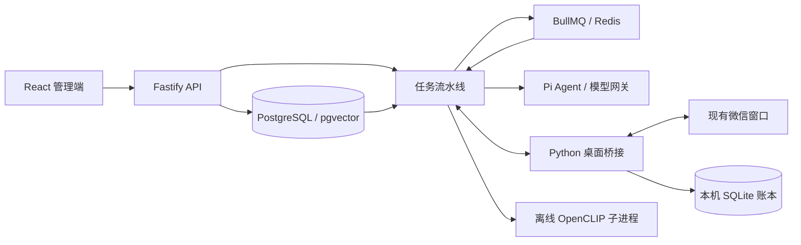

# 架构与数据流

WeChatBot 0.6.1 是模块化单体加独立桌面桥接，不是分布式机器人框架。React/Vite 只负责管理界面；Fastify 组合领域服务和后台任务；Python 桥接拥有微信窗口。各模块依赖显式传入，共享 PostgreSQL 持久状态。

## 服务职责

- `apps/server/app.ts` 组装路由、管理员会话、密钥、服务和桥接子进程。`main.ts` 负责绑定和退出。
- `pipeline.ts` 协调入站、路由、生成、发送、记忆、主动参与和取消；`db.ts` 与迁移维护事务状态，队列不是唯一事实来源。
- `models.ts` 封装 Pi 模型执行，`prompt-cache.ts` 构造稳定缓存上下文，`usage.ts` 记录实际用量；没有价格不能估出虚假总价。
- `knowledge.ts` 与 memory 系列模块维护知识、检索、个人记忆、整合及生命周期；固定规则放系统提示，检索结果作为不可信本轮数据。
- `members.ts` 处理成员和识别证据；群与成员是隔离边界。`community.ts`、`media.ts` 管理菜库与素材。
- chat-images/hunt/gallery/queue 系列模块负责收图、图库快照、匹配、取消与发送前复核；上传内容不自动具有指令权限。
- `bridge/engine.py` 串行桌面操作，`store.py` 持久化 inbox/outbox，`transport.py` 负责认证、重连与 ACK；`wx_adapter.py` 适配窗口，身份辅助模块亦被生产链路使用，不能因文件名有 experiment 就删除。
- `packages/contracts.ts` 是应用与桥接业务契约；浏览器通过 API 与事件通知刷新真实保存状态，不内置假数据。

## 可靠性约束

消息入站与事务 outbox 一起持久化，Redis 发布可以重试。相同事件 ID 只接纳一次，不同事件即使文字相同也保留。任务按用途安排优先级，发送另有账本，不能将模型完成当作发送成功。暂停、群停止或重置会推进 epoch 并取消旧任务，旧生成结果在发送前再次核对。

桥接只操作明确绑定群。命令 ID 防止重复发送；结果不确定不自动重试。UIA 在唯一 COM 线程执行，窗口草稿或群目标不可靠时拒绝发送。临时兼容守护进程与桥接进程树分离，桥接异常后仍须恢复原标志。

## 存储与边界

PostgreSQL 保存配置、消息、任务、发送、知识及版本历史；pgvector 保存可选向量。Redis 用于队列和缓存，SQLite 保存桌面侧可靠收发状态。`data` 存放附件、令牌、DPAPI 密文与本地图像资源，不属于源码。Windows 密钥保护绑定当前用户；跨用户恢复需重新配置密钥。

仅监听回环地址。管理员会话、速率限制、来源检查和桥接令牌分工防护；将端口暴露公网不在支持范围。远程模型、嵌入和搜索服务会收到相应输入，需按群的隐私要求决定是否启用。

## 前端结构与交互如何分工

前端采用 React/TypeScript，而非传统的独立 HTML 模板加手动事件绑定。index.html 提供挂载入口，TSX 中的 JSX 声明界面结构，React 依据组件状态更新 DOM；同一组件中的 TypeScript 处理状态和事件，CSS 文件负责视觉样式。TSX 不是浏览器直接执行的 HTML，构建工具会将其编译成 JavaScript。

这种文件组织不自动等于良好分层。当前 api.ts 提供请求入口，各页面组件仍混合部分表单状态、布局和业务协调，文件较大。后续应按页面容器、展示组件、状态 Hook 和 API/领域函数的职责逐步拆分，保留共享协议与 CSS；不因文件扩展名混合就改写成另一套前端框架。本轮维护仅补说明与格式，不进行组件拆分或界面行为重构。
